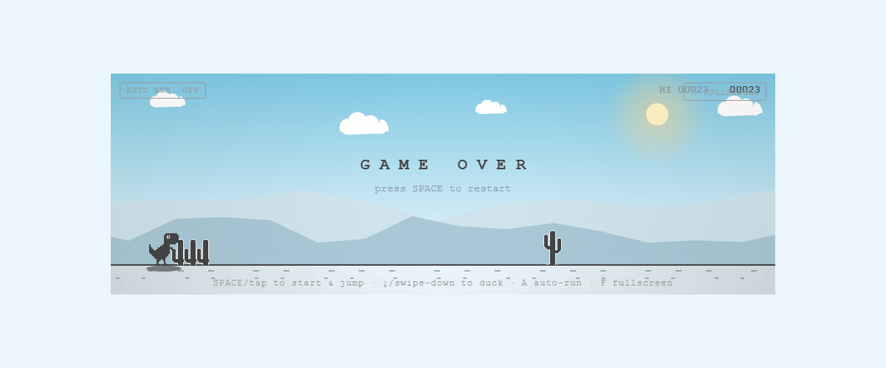
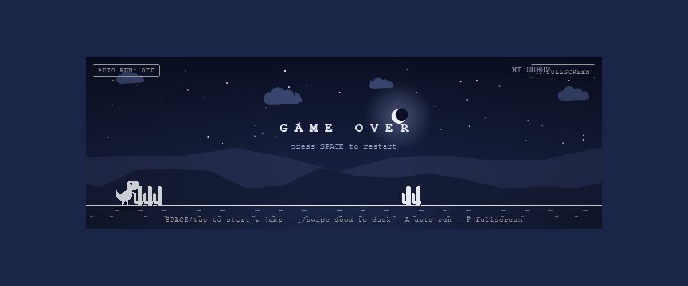
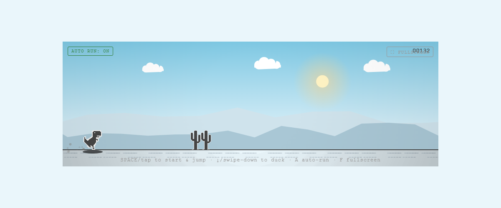
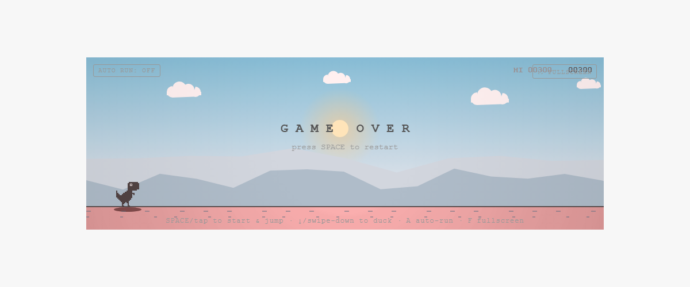

# 🦖 Chrome Dino — Remastered

A faithful, dependency-free remake of the Chrome offline dinosaur game — rebuilt from
the **original Chromium sprites** and layered with a living atmosphere: a continuous
day/night cycle, parallax mountains, dust and speed particles, plus an autopilot bot
that plays the game by your side.

**No frameworks. No build step. No npm install.** One canvas, one game loop, ~34 KB of hand-written JavaScript.

| Day | Night |
|:---:|:---:|
|  |  |

| Autopilot | Game Over |
|:---:|:---:|
|  |  |

---

## ▶️ Play

**Option 1 — zero setup:** open [`dino-game.html`](dino-game.html) in any browser.
It's the complete game in a single file.

**Option 2 — from source:**

```bash
git clone <this-repo>
cd <this-repo>/src
# just open index.html — or serve it:
python3 -m http.server 8000   # then visit http://localhost:8000
```

## 🎮 Controls

| Action | Keyboard | Touch |
|---|---|---|
| Start / Jump | `Space` / `↑` / `W` | Tap |
| Duck | `↓` / `S` | Swipe down (hold to stay ducked) |
| Autopilot on/off | `A` | AUTO RUN button |
| Fullscreen | `F` | ⛶ button |

The world stays frozen until your first jump — exactly like Chrome's waiting screen,
complete with the idle eye-blink.

## ✨ Features

**Authentic core**
- Official 1× `offline-sprite.png` artwork from the Chromium source, embedded as a
  base64 data URI — the real T-Rex (eye, blink, crash face), cacti and pterodactyls
- Chrome-accurate mechanics: ~10 pts/sec scoring, speed ramp 6→13 px/frame, jump arc
  tuned to clear large cacti, duck-only mid-height pterodactyls, high ones pass overhead
- High score persisted in `localStorage`; milestone flash every 100 points

**Visual spectacle**
- Continuous dawn → day → sunset → night cycle (1200 pts per full cycle) with smooth
  palette interpolation across sky, ink, clouds and ground
- Sun and crescent moon arcing overhead, twinkling stars, two parallax mountain ridges
- Two-tone sprite tinting keeps every sprite visible day *and* night — the dino even
  gets a moonlight halo
- Dust kicked up while running, landing puff, speed streaks at high velocity,
  drop shadow that tracks jump height
- Crash juice: screen shake + red flash on collision; vignette that deepens at night

**Extras**
- 🤖 **Autopilot** — a bot that reads obstacles ahead and jumps/ducks using the same
  physics as the player. It crashes occasionally (by design — same jump arc as you),
  then auto-restarts and runs endlessly. Great as a screensaver.
- 📱 Mobile-first: responsive canvas with DPR-capped rendering, touch gestures,
  safe-area-aware fullscreen, rotation-safe resize
- 🖥️ True fullscreen mode

## 🧪 Tests

Zero-dependency headless test suite (plain Node.js, no npm packages):

```bash
tests/run.sh          # or: tests/run.sh path/to/node
```

| Test | What it verifies |
|---|---|
| `syntax` | `game.js` parses cleanly |
| `smoke` | boot → play → crash → restart without errors, loop stays alive |
| `auto` | 6-minute autopilot endurance run — crashes but never gets stuck |
| `mobile` | DPR-capped canvas sizing, tap-jump, swipe-duck, live resize |
| `cactus` | every multi-stem group is exactly `stems × pitch` wide (no sliced art) |
| `perf` | peak canvas ops/frame stays under a 2000-op budget |
| `score` | Chrome-accurate scoring rate, milestone flash, night palette flip |

## 🏗️ Architecture

```
src/
├── index.html     markup + buttons (AUTO RUN, FULLSCREEN)
├── style.css      layout, responsive stage, fullscreen & safe-area rules
└── game.js        everything else (46 functions, no dependencies)
```

**How it's built, in order of the render pipeline:**

1. **Atmosphere engine** — a phase value (`score % 1200 / 1200`) drives piecewise-linear
   interpolation between four hand-tuned palettes (day / sunset / night / dawn). Every
   visual element reads from the current palette object, so the entire scene transitions
   together.
2. **Two-tone sprite tinting** — the source sheet encodes body ink (gray 83) and
   highlights/eye (gray 247+) as distinct tones. At load, the sheet is split once into
   two alpha masks; each frame both masks are tinted with palette colors in isolated
   scratch canvases and composited. This is what keeps the T-Rex's eye visible on any
   background.
3. **Obstacle stitching** — cactus groups are drawn by repeating a single-stem sprite
   at its natural pitch (17 px small / 25 px large), reproducing the interlocking arm
   art exactly instead of cropping wider slices (which visibly sliced arms).
4. **Autopilot** — scans for the nearest obstacle ahead of the snout, then jumps
   (distance threshold scales with speed and obstacle height), ducks under mid-lane
   pterodactyls, or ignores overhead ones. Shares the player's jump physics.

**Why the odd test harness?** The game is a single IIFE with no module system, so the
tests stub the DOM/canvas/rAF globals, inject a state-exposure hook before the IIFE's
closing brace, and drive frames synchronously. It runs anywhere Node does, with nothing
to install.

## 📁 Repository layout

```
├── dino-game.html       standalone single-file build (generated from src/)
├── src/                 readable source (index.html + style.css + game.js)
├── assets/              screenshots + the original Chromium sprite sheet
├── tests/               zero-dependency headless test suite
└── docs/                build notes & decisions
```

## 🙏 Credits

- Sprite artwork: [Chromium offline sprite](assets/offline-sprite.png), by the
  Chromium authors (Sebastien Gabriel et al.) — used here for a fan remake.
- Game design: the Chrome offline T-Rex runner Easter egg.
- Everything else: written from scratch for this project.

## ⚖️ License

MIT — see [LICENSE](LICENSE). The Chromium sprite assets remain the property of their
authors and are included under their original terms for non-commercial fan use.
